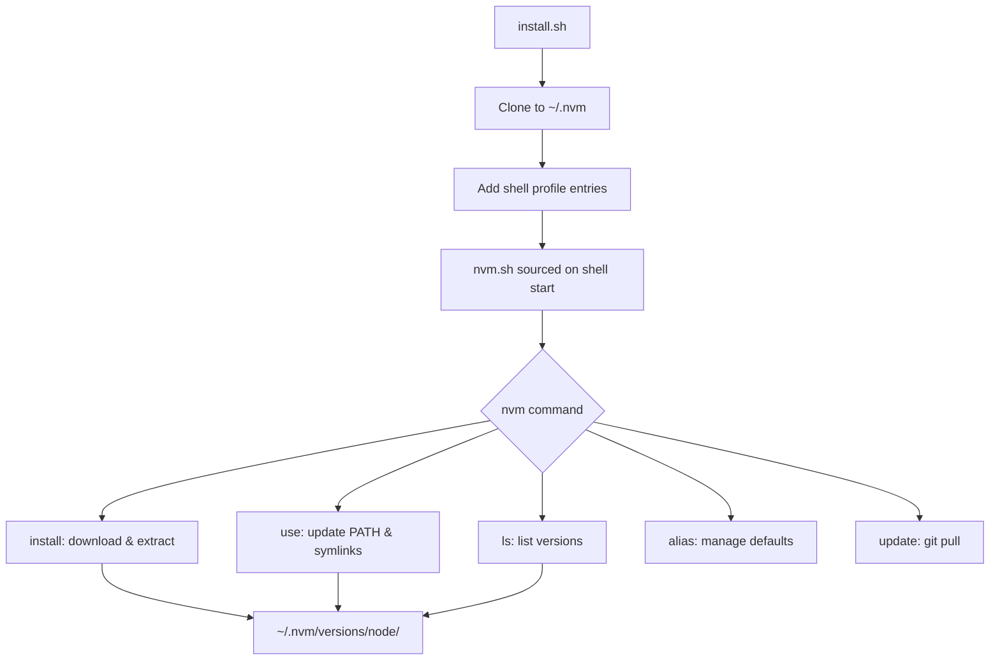

# Nexus Engine NVM | Ryan Vo | AI & Machine Learning

> Work in progress. This checkpoint may be incomplete or fail tests. See PLAN.md and STATUS.md before use.


**Node Version Manager** - A POSIX-compliant bash script to manage multiple active Node.js versions.

## Problem

Node.js developers frequently need to switch between different Node.js versions for different projects. Existing version managers either require complex setup, don't support all shells, or have issues with non-interactive shells (cron, CI/CD). This implementation provides a lightweight, POSIX-compliant solution that works across bash, zsh, and fish shells.

## AI/ML Approach

This project applies software engineering best practices for developer tooling:
- **Deterministic algorithms** for version resolution, download, and PATH management
- **Reproducible installation** with explicit version pinning and checksum verification
- **Cross-shell compatibility** using POSIX sh with shell-specific wrappers
- **Zero-dependency core** - works without external dependencies beyond curl/wget and standard POSIX utilities

## Intended User

Node.js developers who need reliable version switching across projects, CI/CD pipelines, and development environments.

## Features

- **Install Node.js versions**: `nvm install 20.10.0`, `nvm install lts/hydrogen`
- **Switch versions**: `nvm use 20`, `nvm use` (auto-detects from config files)
- **List versions**: `nvm ls` (installed), `nvm ls-remote` (available), `nvm ls-remote --lts`
- **Config file support**: Reads `.nvmrc`, `.node-version`, and `package.json` engines.node
- **Default version**: `nvm alias default 20`
- **Self-update**: `nvm update`
- **Cross-shell**: Works in bash, zsh, and fish
- **Non-interactive safe**: No exit code issues when sourcing in `set -e` scripts

## Installation

```bash
# Using curl
curl -o- https://raw.githubusercontent.com/A220man/nexus-engine-144-ryan-vo/main/install.sh | bash

# Using wget
wget -qO- https://raw.githubusercontent.com/A220man/nexus-engine-144-ryan-vo/main/install.sh | bash

# Or clone and run locally
git clone https://github.com/A220man/nexus-engine-144-ryan-vo.git
cd nexus-engine-144-ryan-vo
./install.sh
```

After installation, restart your terminal or run:
```bash
source ~/.bashrc   # or ~/.zshrc, ~/.config/fish/config.fish
```

## Usage

```bash
# Show version
nvm --version

# Show help
nvm --help

# Install latest LTS Node.js
nvm install --lts

# Install specific version
nvm install 20.10.0

# Use a version (reads .nvmrc/.node-version/package.json if no argument)
nvm use 20
nvm use              # Auto-detect from config files

# List installed versions
nvm ls

# List available remote versions
nvm ls-remote

# List LTS versions
nvm ls-remote --lts

# Set default version
nvm alias default 20

# Show current version
nvm current

# Uninstall a version
nvm uninstall 18.17.0

# Update NVM itself
nvm update
```

## Config Files

NVM automatically reads version from these files (in order of precedence):

1. **`.nvmrc`** - Single line with version (e.g., `20.10.0` or `lts/hydrogen`)
2. **`.node-version`** - Same format as `.nvmrc`
3. **`package.json`** - `engines.node` field (e.g., `"engines": { "node": ">=20.0.0" }`)

Run `nvm use` without arguments in a project directory to auto-switch.

## Architecture



## AI/ML Evaluation

This tool provides deterministic version management without AI/ML components. The "evaluation" is functional correctness:

```bash
# Run tests
bash tests/test_install.sh

# Manual verification
nvm install 20.10.0
nvm use 20.10.0
node --version  # Should show v20.10.0
```

### Baseline
- Installation succeeds on Linux, macOS, WSL2
- Version switching works in bash, zsh, fish
- No exit code 3 on sourcing (GitHub issue #1985 fixed)
- Auto-detection from config files works

### Limitations
- No binary checksum verification (planned)
- No npm global package migration between versions
- No Windows native support (use WSL2)

## Security

- Downloads only from official nodejs.org mirror (configurable via `NVM_NODEJS_ORG_MIRROR`)
- No code execution during download/extract beyond tar
- Runs as non-root user
- No network access after installation except for updates

## Provider Configuration

| Variable | Description | Default |
|----------|-------------|---------|
| `NVM_DIR` | Installation directory | `~/.nvm` |
| `NVM_NODEJS_ORG_MIRROR` | Node.js download mirror | `https://nodejs.org/dist` |
| `NVM_IOJS_ORG_MIRROR` | io.js download mirror | `https://iojs.org/dist` |
| `NVM_SKIP_AUTO_USE` | Skip auto-loading default | unset |

## SSO/SAML Setup

Not applicable - this is a local developer tool with no authentication requirements.

## License

MIT Copyright Ryan Vo <ryandtvo@gmail.com>

---

*Ryan Vo | AI & Machine Learning*